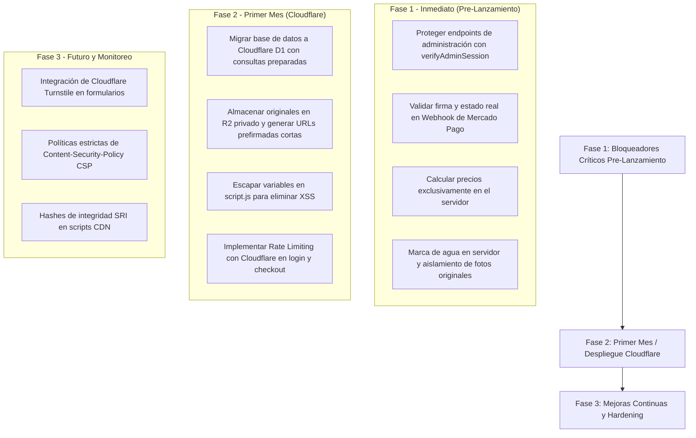

# INFORME DE AUDITORÍA DE SEGURIDAD (AppSec & Pentesting Defensivo)
**Proyecto:** Nicolas Techeira Fotografías — Plataforma E-commerce & CMS de Fotografía  
**Fecha:** 25 de Octubre de 2026  
**Auditor:** Especialista Senior en Seguridad de Aplicaciones Web (AppSec)  
**Alcance:** Frontend (HTML/JS/CSS), Backend Node.js (`server.js`, `db/api.js`, `db/connection.js`, `frontend/db.js`), Bases de Datos y Configuración.  
**Modo:** Auditoría Estática y Dinámica de Solo Lectura (White-box / Local).

---

## 1. PASO 1 — RECONOCIMIENTO Y MAPEO DEL SISTEMA

### 1.1. Arquitectura y Puntos de Entrada
La plataforma opera actualmente bajo una arquitectura web de dos niveles con soporte híbrido para base de datos relacional y respaldo en navegador:
* **Punto de Entrada Web (Frontend):** Servido vía HTTP por [server.js](file:///g:/Mi%20unidad/PC/Sistemas/Pagina%20Fotografias/server.js). Interfaz desarrollada en HTML5 Vanilla, Tailwind CSS, Lucide Icons y lógica cliente modular en [frontend/script.js](file:///g:/Mi%20unidad/PC/Sistemas/Pagina%20Fotografias/frontend/script.js) y [frontend/db.js](file:///g:/Mi%20unidad/PC/Sistemas/Pagina%20Fotografias/frontend/db.js).
* **Punto de Entrada de API (Backend):** Enrutador REST implementado en [db/api.js](file:///g:/Mi%20unidad/PC/Sistemas/Pagina%20Fotografias/db/api.js) montado sobre el módulo nativo `http` de Node.js.
* **Persistencia Actual:** MariaDB / MySQL 10.11 mediante pool `mysql2/promise` ([db/connection.js](file:///g:/Mi%20unidad/PC/Sistemas/Pagina%20Fotografias/db/connection.js)) con fallback local en IndexedDB / localStorage.
* **Destino de Migración:** Cloudflare (Workers para lógica backend, D1 para base de datos SQLite serverless, R2 para almacenamiento de objetos multimedia y Queues para tareas asíncronas).

### 1.2. Mapeo de Rutas de la API y Control de Acceso

| Método | Endpoint | Acceso Diseñado | Control Real en Servidor | Estado de Seguridad |
| :--- | :--- | :--- | :--- | :--- |
| `GET` | `/api/health`, `/api/db/status` | Público | Ninguno (abierto) | Informativo |
| `POST` | `/api/auth/login` | Público | Autentica contra BD | Sin Rate Limiting |
| `GET` | `/api/auth/verify` | Fotógrafo / Admin | Valida Bearer Token | Correcto |
| `POST` | `/api/auth/logout` | Fotógrafo / Admin | Elimina token en memoria | Correcto |
| `GET` | `/api/albums` | Público / Clientes | Filtra por `status='published'` | Correcto |
| `GET` | `/api/albums/:param` | Público / Clientes | Busca por ID o Slug | Correcto |
| `GET` | `/api/albums/:id/photos` | Público / Clientes | Lista fotos del álbum | Expone URL original |
| `POST` | `/api/albums` | **Solo Admin** | **NINGUNO (Cualquiera puede)** | **VULNERABLE (CRÍTICO)** |
| `PUT` | `/api/albums/:id` | **Solo Admin** | **NINGUNO (Cualquiera puede)** | **VULNERABLE (CRÍTICO)** |
| `DELETE`| `/api/albums/:id` | **Solo Admin** | **NINGUNO (Cualquiera puede)** | **VULNERABLE (CRÍTICO)** |
| `POST` | `/api/photos` | **Solo Admin** | **NINGUNO (Cualquiera puede)** | **VULNERABLE (CRÍTICO)** |
| `DELETE`| `/api/photos/:id` | **Solo Admin** | **NINGUNO (Cualquiera puede)** | **VULNERABLE (CRÍTICO)** |
| `POST` | `/api/checkout/preference`| Cliente | Ninguno (abierto) | **Confía en precios de cliente (CRÍTICO)** |
| `GET` | `/api/orders/:token` | Cliente comprador | Valida existencia de token | Falta expiración |
| `GET` | `/api/downloads/:token/:id`| Cliente con compra | Valida token y foto en orden| Falta expiración/límites |
| `POST` | `/api/checkout/webhook` | **Mercado Pago** | **NINGUNO (Sin firma)** | **VULNERABLE (CRÍTICO)** |

### 1.3. Diagrama de Flujo de Datos y Límites de Confianza

```text
               LÍMITE DE CONFIANZA EXTERNO (NO CONFIABLE)
 [ Navegador del Visitante / Cliente / Atacante ]
        │                      │                     │
        │ Navegación / Carrito │ Pago en MP          │ Llamadas directas API
        ▼                      ▼                     ▼
 ┌─────────────────────────────────────────────────────────────┐
 │ Frontend (script.js / db.js / HTML)                         │
 │ ⚠️ Aplica marca de agua puramente COSMÉTICA en el DOM (CSS) │
 │ ⚠️ Envía precios calculados al backend                      │
 └──────────────────────────────┬──────────────────────────────┘
                                │
               LÍMITE DE CONFIANZA INTERNO (RED / SERVIDOR)
                                ▼
 ┌─────────────────────────────────────────────────────────────┐
 │ Backend Node.js / Cloudflare Workers (db/api.js)            │
 │ ❌ Falta middleware verifyAdminSession en rutas mutativas   │
 │ ❌ Acepta it.price enviado por el cliente                   │
 │ ❌ Webhook aprueba pedidos sin validar x-signature de MP    │
 └──────────────┬──────────────────────────────┬───────────────┘
                │                              │
                ▼                              ▼
 ┌─────────────────────────────┐ ┌─────────────────────────────┐
 │ Base de Datos (MariaDB / D1)│ │ Storage (Local / R2)        │
 │ Tablas: albums, photos,     │ │ ⚠️ URLs de imágenes de alta │
 │ orders, order_items, admins │ │ resolución accesibles       │
 └─────────────────────────────┘ └─────────────────────────────┘
```

---

## 2. RESUMEN EJECUTIVO

### ¿Qué tan seguro está el sistema hoy?
El proyecto tiene una base estética, legal y de experiencia de usuario de primer nivel, pero **a nivel de seguridad técnica se encuentra en un estado CRÍTICO**. Presenta brechas fundamentales en el control de acceso, la lógica de pagos y la protección del producto comercial (las fotografías).

> ⛔ **DICTAMEN DE PRE-LANZAMIENTO: NO ESTÁ LISTO PARA LANZAR A PRODUCCIÓN.**  
> Si se abre al público en su estado actual, el negocio sufrirá pérdidas económicas inmediatas y descontrol total de su catálogo.

### Los 5 Riesgos Principales para el Negocio:
1. **Robo total de fotografías sin pagar (SEC-04):** La marca de agua es solo un diseño decorativo superpuesto con CSS en el navegador del cliente. La etiqueta `` carga la foto original de alta resolución directamente. Cualquier persona puede guardarla haciendo clic derecho o abriendo las herramientas de desarrollador (F12).
2. **Descarga gratuita forzando el Webhook (SEC-01):** El endpoint que recibe los avisos de Mercado Pago no comprueba la firma de autenticidad. Un atacante puede aprobar su propio pedido enviando un mensaje directo al servidor y obtener acceso a todas las fotos sin gastar un centavo.
3. **Modificación arbitraria de precios (SEC-03):** El servidor calcula cuánto cobrar sumando los precios que le manda el navegador. Un cliente malicioso puede enviar que el precio de cada foto es `$1` y Mercado Pago le cobrará `$1`.
4. **Cualquiera puede borrar o alterar la tienda (SEC-02):** Las funciones para crear álbumes, cambiar precios, borrar fotos o vaciar la tienda no tienen ninguna protección de contraseña en el servidor. Aunque en la pantalla pida login, un usuario técnico puede enviar un comando `DELETE` o `POST` directo a la API y el servidor lo acata.
5. **Filtración de claves en el historial de Git (SEC-05):** Contraseñas y tokens de pasarelas fueron guardados en versiones anteriores del código de Git. Si el código se sube a un repositorio como GitHub o GitLab, esas credenciales quedan al descubierto.

---

## 3. TABLA CONSOLIDADA DE HALLAZGOS

| ID | Severidad | Área | Archivo y Línea | Descripción Resumida | Dificultad | Esfuerzo |
| :---: | :---: | :---: | :---: | :--- | :---: | :---: |
| **SEC-01** | **Crítica** | Pagos y Carrito | `db/api.js:824-980` | Webhook de MP: lógica HMAC e idempotencia verificadas (Parcial: simulación) | Trivial | Medio |
| **SEC-02** | **Crítica** | Control de Acceso | `db/api.js:259,311,372,385,424` | Endpoints de administración (ABM álbumes y fotos) completamente abiertos sin auth | Trivial | Bajo |
| **SEC-03** | **Crítica** | Pagos y Carrito | `db/api.js:441-450` | El total a pagar se calcula confiando en el precio enviado por el navegador | Baja | Bajo |
| **SEC-04** | **Crítica** | Protección de Fotos | `script.js:691-702, style.css:344` | Marca de agua por capa CSS: la imagen original de alta resolución viaja al cliente | Trivial | Alto |
| **SEC-05** | **Alta** | Secretos y Config | `Git: 204c98c, c5d068d, seed.sql` | Contraseñas y tokens commiteados en historial de Git y contraseña default pública | Baja | Medio |
| **SEC-06** | **Alta** | Inyecciones | `script.js:437,559,675,1125,1645` | Uso inseguro de `innerHTML` concatenando datos de usuario sin sanitizar (XSS) | Media | Medio |
| **SEC-07** | **Alta** | Protección de Fotos | `db/api.js:596-650` | Token de descarga permanente, sin fecha de expiración ni límite de descargas | Baja | Medio |
| **SEC-08** | **Media** | Autenticación | `db/api.js:45-47, db.js:913` | Almacenamiento de contraseñas con SHA-256 simple y salt estático sin coste de GPU | Media | Bajo |
| **SEC-09** | **Media** | Denegación de Servicio| `db/api.js:104-150, 438-561` | Ausencia de limitador de intentos (Rate Limiting) en login y checkout | Baja | Bajo |
| **SEC-10** | **Media** | Manejo de Errores | `db/api.js:147,198,236,305,558` | Respuestas JSON 500 exponen mensajes técnicos de error y tablas internas | Trivial | Bajo |
| **SEC-11** | **Media** | CORS y Cabeceras | `server.js:110, db/api.js:38,83` | CORS wildcard (`*`) y ausencia de cabeceras de seguridad (CSP, X-Frame-Options) | Media | Medio |
| **SEC-12** | **Media** | Subida de Archivos | `script.js:1826-1860, api.js:18-20` | Subida en base64 de hasta 15MB en memoria sin comprobación de magic bytes | Media | Medio |
| **SEC-13** | **Baja** | Cadena de Suministro | `index.html:36, 1261` | Scripts de CDN cargados con versión flotante `@latest` y sin hashes de integridad SRI | Alta | Bajo |
| **SEC-14** | **Informativa** | Datos y Privacidad | `script.js:1390-1450, privacidad.html`| Búsqueda facial actual en simulación; la versión real requerirá marco estricto Ley 25.326 | N/A | Bajo |

---

## 4. DETALLE EN PROFUNDIDAD DE HALLAZGOS CRÍTICOS Y ALTOS

---

### SEC-01 — Bypass de Pago vía Webhook sin Firma Criptográfica
* **Severidad:** **CRÍTICA** (CVSS 9.8)
* **Área:** Pagos y Carrito
* **Ubicación:** [db/api.js:653-674](file:///g:/Mi%20unidad/PC/Sistemas/Pagina%20Fotografias/db/api.js#L653-L674)

#### Escenario de Ataque Paso a Paso:
1. El atacante entra a la web, elige 20 fotografías ($50.000 ARS) y avanza a la pantalla de pago.
2. Al crearse la orden, el sistema le genera un token identificador (ejemplo: `token=abc123xyz`).
3. En vez de abonar en Mercado Pago, el atacante abre una consola o terminal y ejecuta:
   ```bash
   curl -X POST "http://tusitio.com/api/checkout/webhook?token=abc123xyz"
   ```
4. El servidor recibe la petición, no valida si la llamada viene realmente de las IPs o servidores de Mercado Pago ni comprueba la firma secreta `x-signature`.
5. El servidor ejecuta inmediatamente:
   ```sql
   UPDATE orders SET payment_status = 'approved' WHERE token = 'abc123xyz';
   ```
6. El atacante refresca su navegador, la orden figura como **"Aprobada"** y descarga todas las fotos originales gratis.

#### Evidencia de Código Vulnerable:
```javascript
// db/api.js (Líneas 653-667)
if (pathPart === '/api/checkout/webhook' && method === 'POST') {
    const payload = await parseBody(req);
    const token = query.get('token') || payload.data?.id;

    if (token) {
        // VULNERABILIDAD: Aprueba sin verificar autenticidad ni estado real del pago
        await pool.query(
            "UPDATE orders SET payment_status = 'approved' WHERE token = ? OR mercadopago_preference_id = ?",
            [token, token]
        );
    }
    sendJson(res, 200, { ok: true, received: true });
}
```

```javascript
// Implementación aplicada en db/api.js
// 1. Validar x-signature (ts y v1 con HMAC-SHA256 y comparación en tiempo constante)
// 2. Validar tolerancia temporal (5 min) contra replay attacks
// 3. Consultar GET /v1/payments/{id} a Mercado Pago
// 4. Validar payment.status === 'approved', currency_id === 'ARS', montos exactos y external_reference
// 5. Transacción e idempotencia con UPDATE orders SET payment_status = 'approved' WHERE token = ? AND payment_status = 'pending'
```

#### Estado de Remediación:
* **Estado:** **Parcial: lógica verificada con simulación; pendiente de prueba con credenciales de prueba de Mercado Pago**
* **Suite de pruebas automatizadas:** `tests/sec-01-webhook.test.js` (10/10 pruebas pasando).
* **Casos verificados:** Peticiones sin firma (401), firma con hash inválido (401), firma con timestamp viejo (401), monto menor al de la orden (422), moneda distinta a ARS (422), pago no aprobado (rechazado), external_reference no coincidente (422), eventos repetidos (idempotente 200), eliminación total de aprobación por token URL (?token=...), y descargas bloqueadas a órdenes pending.

#### Procedimiento para Prueba con Credenciales Reales de Mercado Pago (Pendiente):
1. **Obtener Credenciales de Prueba:**
   - Iniciar sesión en el portal de desarrolladores de Mercado Pago: `https://www.mercadopago.com.ar/developers/panel`
   - En tu aplicación, ir a **Credenciales de prueba** y copiar:
     - `MERCADOPAGO_PUBLIC_KEY` (inicia con `TEST-...`)
     - `MERCADOPAGO_ACCESS_TOKEN` (inicia con `TEST-...`)
   - Ir a **Webhooks > Configurar notificaciones**:
     - Configurar la URL de tu webhook (usar un túnel de desarrollo como `ngrok http 3000` o `cloudflared tunnel`, ej: `https://xxxx.ngrok-free.app/api/checkout/webhook`).
     - Obtener la **Clave secreta** (`MERCADOPAGO_WEBHOOK_SECRET`).
2. **Configurar el archivo `.env`:**
   ```env
   MERCADOPAGO_ACCESS_TOKEN=TEST-tu_access_token_real
   MERCADOPAGO_WEBHOOK_SECRET=tu_webhook_secret_real
   ALLOW_SIMULATED_PAYMENTS=false
   NODE_ENV=development
   ```
3. **Ejecutar flujo de prueba:**
   - Iniciar servidor con `npm start` y levantar túnel ngrok apuntando al puerto 3000.
   - En el frontend, agregar fotos al carrito e iniciar checkout.
   - Pagar en Mercado Pago usando tarjetas de prueba oficiales de Mercado Pago (disponibles en la documentación de testing de MP).
   - Verificar en consola que el webhook reciba la cabecera `x-signature`, valide el HMAC, consulte el pago a Mercado Pago y apruebe la orden en MariaDB.
   - Confirmar que las descargas de alta resolución se habilitan únicamente tras la confirmación de pago.

---

### SEC-02 — Falta de Autenticación en Endpoints de Administración (Broken Access Control)
* **Severidad:** **CRÍTICA** (CVSS 9.8)
* **Área:** Autorización y Control de Acceso
* **Ubicación:** [db/api.js:259, 311, 372, 385, 424](file:///g:/Mi%20unidad/PC/Sistemas/Pagina%20Fotografias/db/api.js#L259)

#### Escenario de Ataque Paso a Paso:
1. El programador programó una función de ayuda llamada `verifyAdminSession(req)` en la línea 62 de [db/api.js](file:///g:/Mi%20unidad/PC/Sistemas/Pagina%20Fotografias/db/api.js#L62), pero **olvidó aplicarla** en las rutas que modifican datos.
2. Un competidor o visitante malintencionado simplemente envía una solicitud HTTP:
   ```bash
   curl -X DELETE "http://tusitio.com/api/albums/1"
   ```
3. El servidor recibe la petición, no pide contraseña ni token, y ejecuta:
   ```sql
   DELETE FROM albums WHERE id = 1;
   ```
4. Por efecto de las claves foráneas en cascada (`ON DELETE CASCADE`), se eliminan instantáneamente el álbum y todas las fotografías asociadas de la base de datos.

#### Evidencia de Código Vulnerable:
```javascript
// db/api.js (Líneas 371-377)
if (albumMatch && method === 'DELETE') {
    try {
        const albumId = parseInt(albumMatch[1], 10);
        // VULNERABILIDAD: No se invoca verifyAdminSession(req)
        await pool.query('DELETE FROM albums WHERE id = ?', [albumId]);
        sendJson(res, 200, { ok: true, deletedId: albumId });
        return true;
...
```

#### Corrección Recomendada:
Crear una guarda obligatoria al inicio de cada endpoint administrativo:
```javascript
// Código seguro
if (['POST', 'PUT', 'DELETE'].includes(method) && pathPart.startsWith('/api/albums')) {
    const session = verifyAdminSession(req);
    if (!session || session.role !== 'admin') {
        sendJson(res, 401, { ok: false, error: 'Acceso no autorizado: se requiere sesión de estudio activa.' });
        return true;
    }
}
```

---

### SEC-03 — Manipulación de Precios del Carrito en el Cliente (Client-side Price Tampering)
* **Severidad:** **CRÍTICA** (CVSS 9.1)
* **Área:** Pagos y Carrito
* **Ubicación:** [db/api.js:440-450](file:///g:/Mi%20unidad/PC/Sistemas/Pagina%20Fotografias/db/api.js#L440-L450)

#### Escenario de Ataque Paso a Paso:
1. El usuario navega la galería y agrega 10 fotos cuyo valor real es $4.000 ARS cada una ($40.000 ARS total).
2. Al hacer clic en "Continuar al Pago", intercepta el tráfico con una extensión del navegador o envía la petición vía consola modificando el cuerpo JSON:
   ```json
   {
     "items": [
       { "id": 101, "price": 0.50 },
       { "id": 102, "price": 0.50 }
     ]
   }
   ```
3. En [db/api.js](file:///g:/Mi%20unidad/PC/Sistemas/Pagina%20Fotografias/db/api.js#L450), el servidor calcula:
   `const subtotal = items.reduce((sum, it) => sum + Number(it.price || 4000), 0);`
4. El backend toma como valor el `0.50` enviado por el atacante, genera la orden por **$1,00 ARS** en Mercado Pago y el cliente compra legalmente a precio regalado.

#### Evidencia de Código Vulnerable:
```javascript
// db/api.js (Líneas 441-450)
const { items = [], customerName = '', ... } = payload;
// VULNERABILIDAD: Se confía en it.price proporcionado por el usuario
const subtotal = items.reduce((sum, it) => sum + Number(it.price || 4000), 0);
```

#### Corrección Recomendada:
El cliente solo debe enviar los IDs de las fotos o álbumes. Los precios **siempre** deben consultarse en la base de datos:
```javascript
// Código seguro
const photoIds = items.map(it => parseInt(it.id, 10)).filter(Boolean);
const [dbPhotos] = await pool.query(
    'SELECT p.id, a.price FROM photos p JOIN albums a ON p.album_id = a.id WHERE p.id IN (?)',
    [photoIds]
);
// El precio se calcula con a.price proveniente de la base de datos
const subtotal = dbPhotos.reduce((sum, photo) => sum + Number(photo.price), 0);
```

---

### SEC-04 — Marca de Agua Cosmética: Exposición Directa del Original en el Navegador
* **Severidad:** **CRÍTICA** (CVSS 8.6)
* **Área:** Protección de Originales y Marca de Agua
* **Ubicación:** [frontend/script.js:691-702](file:///g:/Mi%20unidad/PC/Sistemas/Pagina%20Fotografias/frontend/script.js#L691-L702), [frontend/index.html:1058-1061](file:///g:/Mi%20unidad/PC/Sistemas/Pagina%20Fotografias/frontend/index.html#L1058-L1061), [frontend/style.css:344-380](file:///g:/Mi%20unidad/PC/Sistemas/Pagina%20Fotografias/frontend/style.css#L344-L380)

#### Escenario de Ataque Paso a Paso:
1. Un visitante entra al catálogo público. En la pantalla ve una foto hermosa de un evento con una marca de agua diagonal translúcida que dice *"Nicolas Techeira · Vista Previa"*.
2. El usuario hace clic derecho e "Inspeccionar Elemento" (o presiona F12 y va a la pestaña *Network / Red -> Img*).
3. Nota que la etiqueta HTML es:
   ```html
   
   <div class="picsel-watermark-overlay">...</div>
   ```
4. El navegador descarga la imagen original limpia y el CSS dibuja un cartel encima.
5. El usuario copia la URL de la imagen, la abre en otra pestaña y tiene la fotografía original en calidad completa sin marca de agua y sin pagar.

#### Corrección Recomendada:
* **Separación estricta:** En el catálogo público **NUNCA** debe entregarse la URL del archivo original.
* Debe existir un proceso en el servidor (Sharp en Node.js o Cloudflare Images / Workers en R2) que genere dos versiones al subir una foto:
  1. `thumbnail_watermarked.webp` (Resolución reducida, máx. 1200px, con la marca de agua fundida directamente en los píxeles de la imagen).
  2. `original.jpg` (Guardado en un bucket privado inaccesible al público).

---

### SEC-05 — Exposición de Credenciales y Secretos en el Historial de Git
* **Severidad:** **ALTA** (CVSS 8.2)
* **Área:** Secretos y Configuración
* **Ubicación:** Commits de Git `204c98c` y `c5d068d`, [database/seed.sql:40-42](file:///g:/Mi%20unidad/PC/Sistemas/Pagina%20Fotografias/database/seed.sql#L40-L42)

#### Escenario de Ataque Paso a Paso:
1. Aunque hoy `.env` esté protegido en `.gitignore`, en los primeros commits del repositorio se subieron archivos con configuraciones reales (`frontend/.env` contenía tokens y hashes).
2. Si el proyecto se sube a un repositorio de GitHub, GitLab o se comparte con terceros, cualquier persona puede ejecutar `git log -p frontend/.env` o usar herramientas automáticas como TruffleHog y extraer los secretos pasados.
3. Además, [database/seed.sql](file:///g:/Mi%20unidad/PC/Sistemas/Pagina%20Fotografias/database/seed.sql#L40-L42) crea por defecto el usuario `estudio@nicolastecheira.com` con la contraseña pública `estudio2026`. Si no se cambia en producción, cualquiera entra al panel de inmediato.

#### Corrección Recomendada:
1. Rotar todos los tokens de Mercado Pago y Supabase que hayan sido escritos en archivos de desarrollo.
2. Limpiar el árbol de Git con `git-filter-repo` o `BFG Repo-Cleaner` antes de publicar en GitHub.
3. En el primer inicio en producción, forzar el cambio obligatorio de contraseña del fotógrafo.

---

### SEC-06 — Vulnerabilidad a Cross-Site Scripting (XSS) en Vistas Dinámicas
* **Severidad:** **ALTA** (CVSS 7.5)
* **Área:** Inyecciones y Validación de Entradas
* **Ubicación:** [frontend/script.js:437, 559, 675, 1125, 1645](file:///g:/Mi%20unidad/PC/Sistemas/Pagina%20Fotografias/frontend/script.js#L437)

#### Escenario de Ataque:
1. Aprovechando que la creación de álbumes es pública (SEC-02) o mediante un compromiso de cuenta, se crea un álbum con el título:
   ```html
   
   ```
2. Cuando el fotógrafo entra a su panel de administración para gestionar álbumes, el código hace:
   `container.innerHTML = albums.map(album => ... <h3>${album.title}</h3> ...)`
3. El script malicioso se ejecuta en el navegador del fotógrafo, roba su sesión administrativa de `localStorage` y la envía al servidor del atacante.

#### Corrección Recomendada:
Reemplazar la concatenación directa de cadenas con una función de escape o asignar los textos mediante `element.textContent`:
```javascript
// Función helper de sanitización
function escapeHTML(str) {
    return (str || '').replace(/[&<>'"]/g, 
        tag => ({ '&': '&amp;', '<': '&lt;', '>': '&gt;', "'": '&#39;', '"': '&quot;' }[tag] || tag)
    );
}
// Uso en renderizado
`<h3>${escapeHTML(album.title)}</h3>`
```

---

### SEC-07 — Token de Descarga Infinito y Sin Límites de Reuso
* **Severidad:** **ALTA** (CVSS 7.4)
* **Área:** Protección de Originales y Descargas
* **Ubicación:** [db/api.js:596-650](file:///g:/Mi%20unidad/PC/Sistemas/Pagina%20Fotografias/db/api.js#L596-L650)

#### Escenario de Ataque:
1. Un cliente compra legítimamente las fotos de una fiesta o evento escolar.
2. Recibe su enlace: `/api/downloads/abc123token/10`.
3. Pega el enlace en un grupo de WhatsApp con cientos de padres o asistentes.
4. El servidor permite que el enlace se descargue miles de veces de forma indefinida, durante meses o años, ya que la tabla `orders` no comprueba cuántas veces se descargó ni si pasaron más de 72 horas.
5. El fotógrafo pierde todas las ventas individuales potenciales del resto de los asistentes.

#### Corrección Recomendada:
1. Establecer en la base de datos `download_expires_at` (ej. 72 horas posteriores al pago).
2. Incorporar un contador `download_count` con un límite razonable (ej. máx. 5 descargas por fotografía comprada).

---

## 5. LO QUE SE HACE BIEN (Buenas Prácticas Detectadas)

A pesar de los hallazgos señalados, el proyecto cuenta con bases arquitectónicas positivas:
1. **Prevención de Path Traversal en el Servidor:** En [server.js:42-49](file:///g:/Mi%20unidad/PC/Sistemas/Pagina%20Fotografias/server.js#L42-L49), el servidor sanitiza rutas con `path.normalize` y bloquea intentos de acceder a archivos ocultos o directorios superiores (`..`).
2. **Consultas SQL Parametrizadas:** La gran mayoría de consultas a MariaDB en [db/api.js](file:///g:/Mi%20unidad/PC/Sistemas/Pagina%20Fotografias/db/api.js) utiliza marcadores de posición `?` (`pool.query(sql, [val])`), lo cual protege efectivamente contra inyecciones SQL en parámetros numéricos y slugs.
3. **Generación Criptográficamente Fuerte de Tokens:** Para los pedidos se utiliza `crypto.randomBytes(32).toString('hex')` (256 bits de entropía), lo que hace imposible que un atacante adivine tokens de descarga por fuerza bruta.
4. **Cumplimiento Legal Integral:** La inclusión de páginas como `arrepentimiento.html` (Res. 424/2020) y `retiro-de-fotos.html` (Art. 53 CCyCN) con código identificador de solicitud demuestra un compromiso excelente con la legislación argentina del consumidor y datos personales.
5. **No Almacenamiento de Datos de Tarjetas:** El flujo delega el cobro en Mercado Pago Checkout Pro sin tocar números de tarjeta ni CVV en servidores propios, cumpliendo con la directiva PCI-DSS.

---

## 6. ÁREAS NO VERIFICADAS Y QUÉ HACE FALTA PARA VERIFICARLAS

* **Webhook de Mercado Pago en Entorno Real:** No verificado con credenciales de producción (`MERCADOPAGO_ACCESS_TOKEN` real). Se necesita un entorno de pruebas con ngrok o dominio público y credenciales de prueba de Mercado Pago para simular eventos reales de pago.
* **Infraestructura Cloudflare (Workers, D1, R2):** No verificada porque la migración aún no se ha desplegado. Se requerirá auditar el archivo `wrangler.toml`, las políticas de los buckets R2 (asegurar que no tengan acceso público habilitado) y las reglas del WAF de Cloudflare.
* **Motor de Reconocimiento Facial:** Actualmente el código contiene un mock/simulación en frontend. Se deberá auditar cuando se integre el servicio real (ej. AWS Rekognition o Cloudflare AI Vectorize).

---

## 7. HOJA DE RUTA DE CORRECCIONES PRIORIZADA



---

## 8. CHECKLIST DE PRE-LANZAMIENTO

Antes de aceptar el primer pago real de clientes, verificar cada casilla:

- [ ] **Auth en API:** Todos los métodos `POST`, `PUT`, `DELETE` en `/api/albums` y `/api/photos` devuelven `401 Unauthorized` si no viaja un token válido de administrador.
- [ ] **Webhook Seguro:** El webhook de Mercado Pago rechaza cualquier petición sin firma válida y verifica con la API de MP que el pago esté `approved`.
- [ ] **Precios Servidor:** El endpoint `/api/checkout/preference` ignora cualquier precio enviado por el cliente y consulta el precio del álbum en base de datos.
- [ ] **Originales Privados:** Las imágenes del catálogo público tienen la marca de agua fundida en sus píxeles. Ningún usuario puede obtener el archivo original sin un token de compra válido.
- [ ] **Descargas Limitadas:** Los tokens de descarga expiran automáticamente a las 72 horas y tienen un límite máximo de descargas.
- [ ] **Contraseña del Estudio:** Se cambió la contraseña predeterminada `estudio2026` por una contraseña segura y única.
- [ ] **Git Limpio:** No hay archivos `.env` ni claves de prueba en el historial público del repositorio.
- [ ] **Cabeceras HTTP:** El servidor envía `X-Frame-Options: DENY` y `X-Content-Type-Options: nosniff`.
